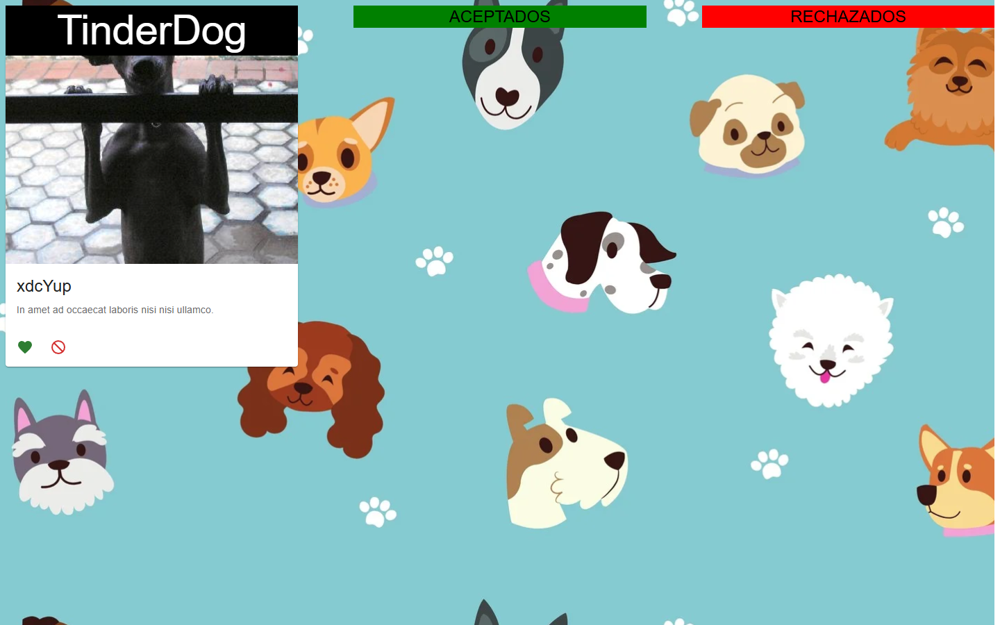

# TinderDog

Aplicación web al estilo "Tinder" para perros: muestra fotos aleatorias de perros y permite aceptarlas o rechazarlas.


<p align="center"></p>

## Tabla de contenidos

- [Descripción](#descripción)
- [Estado del proyecto](#estado-del-proyecto)
- [Características](#características)
- [Tecnologías](#tecnologías)
- [Requisitos](#requisitos)
- [Instalación](#instalación)
- [Uso](#uso)
- [Estructura del proyecto](#estructura-del-proyecto)
- [Licencia](#licencia)
- [Autor](#autor)

## Descripción

Ejercicio académico desarrollado en React. Cada tarjeta muestra una imagen aleatoria obtenida de la API pública [Dog CEO](https://dog.ceo/dog-api/), junto con un nombre y una descripción de texto generados aleatoriamente. El usuario decide si acepta o rechaza al perro, y puede mover los perros ya clasificados de una lista a la otra.

## Estado del proyecto

**Ejercicio académico.** Proyecto de práctica en React, sin desarrollo activo.

## Características

- Imágenes aleatorias de perros desde `https://dog.ceo/api/breeds/image/random`.
- Nombre aleatorio y descripción generada con `lorem-ipsum` para cada perro.
- Botones para aceptar o rechazar, con indicador de carga mientras llega la siguiente imagen.
- Listas de perros aceptados y rechazados, con la opción de cambiar un perro de una a otra.
- Interfaz construida con Material UI.

## Tecnologías

- React 18
- Vite 3
- Material UI 5 (`@mui/material`, `@mui/icons-material`) y Emotion
- React Query (`@tanstack/react-query`)
- lorem-ipsum

## Requisitos

- Node.js y npm

## Instalación

```bash
git clone https://github.com/ViceAguilera/TinderDog.git
cd TinderDog
npm install
```

## Uso

```bash
npm run dev       # servidor de desarrollo
npm run build     # build de producción
npm run preview   # previsualizar el build
```

## Estructura del proyecto

```
index.html          Documento HTML base
public/             Logo y fondo
src/main.jsx        Punto de entrada de React
src/App.jsx         Componente principal (tarjeta, listas de aceptados y rechazados)
src/utils/getDog.js Consulta a la API de Dog CEO
```

## Licencia

Distribuido bajo la licencia MIT. Ver [LICENSE](LICENSE).

## Autor

**Vicente Aguilera Arias** — [Portafolio](https://portfolio.iamsirius.cl) · [GitHub](https://github.com/ViceAguilera) · [LinkedIn](https://www.linkedin.com/in/vicenteaguilera/)
